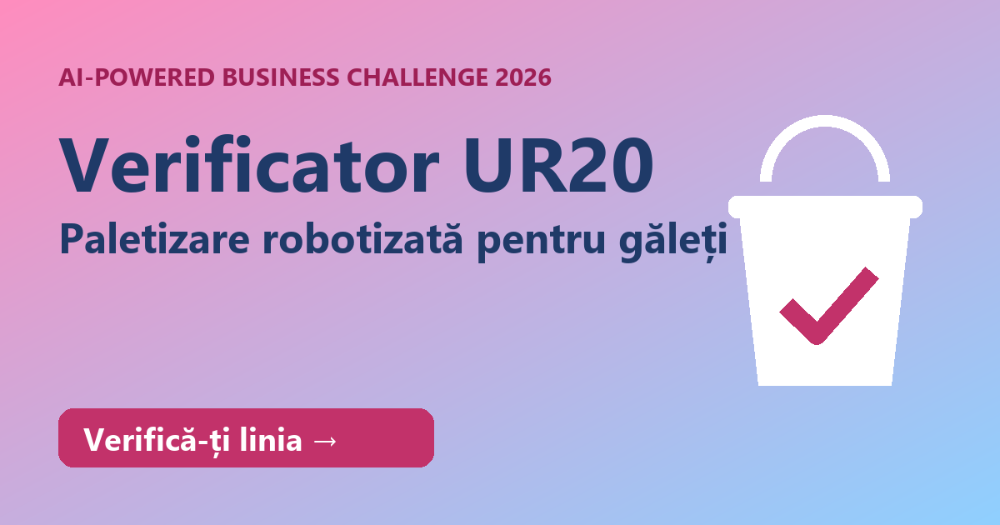

# Verificator UR20



**Prototip web (PWA)** care ajută directorii de producție din fabricile alimentare din România să afle dacă linia lor de găleți se potrivește pentru o celulă de paletizare robotizată cu **Universal Robots UR20**, după modelul implementat de Tech-Con la PURATOS. Apoi pot solicita o evaluare tehnică.

**Aplicația live:** https://bitlee1407.github.io/verificator-ur20/

Realizat pentru **AI-Powered Business Challenge 2026** (Start Your StartUP · Tech-Con · Secțiunea Studenți) · cod echipă **SYSUP072JD**.

---

## Ce face

1. **Linia ta**: greutatea găleții, mânerul, debitul liniei (găleți/minut), schimburi, ore pe schimb, tip palet, separatoare, mediu de lucru.
2. **Rezultat orientativ**:
   - compatibilitate: în limitele testate / necesită validare / nepotrivit pentru configurația testată;
   - celule necesare față de ritmul testat (7,4 găleți/min la 13 kg, 8,6 la 5 kg);
   - găleți și paleți pe schimb, frecvența schimbării paleților;
   - tone ridicate manual evitate pe schimb și pe zi;
   - checklist de validare adaptat liniei.
3. **Solicită evaluare tehnică**: formular cu validarea datelor (câmpuri obligatorii, format e-mail și telefon RO, consimțământ) și scor de calificare a cererii.
4. **Flux automat (simulat)**:
   - rutare la cel mai apropiat centru Tech-Con (Dragomirești-Deal, Iași, Timișoara), după distanța față de reședința județului;
   - fișă CRM cu ID și etapă în pâlnie;
   - secvență de 3 e-mailuri programate (zilele 0/3/7, sau 0/7/14 pentru cererile „de nutrit”);
   - sarcină pentru inginer, cu termen la +2 zile lucrătoare.
5. **Panou CRM** cu export `.csv` pentru Excel, rezumat `.txt` și programarea demonstrației în calendar (`.ics`).

Nimic nu este trimis real: aplicația nu are server, iar datele rămân doar în browser.

## Cum testezi (2 minute)

| Pas | Acțiune | Rezultat așteptat |
|---|---|---|
| 1 | «Exemplu normal» → «Calculează» | „În limitele testate”, 1 celulă, 3.360 găleți/schimb, 76,4 paleți/schimb, 43,7 t/schimb |
| 2 | «Solicită evaluare tehnică» → «Completează date fictive» → «Trimite» | Scor de calificare + fluxul automat în 4 pași |
| 3 | Schimbă județul (ex. Bacău, Timiș) și trimite din nou | Centrul atribuit se schimbă (Iași, Timișoara) |
| 4 | «Modifică datele» → «Exemplu cu date greșite» → «Calculează» | Calculul e blocat, apar 3 erori |
| 5 | Greutate 14 kg / 16 kg | „Necesită validare tehnică” / „Nepotrivit pentru UR20” |

## Tehnologie

- HTML, CSS și JavaScript simplu, fără framework-uri, fără build și fără dependențe externe
- **PWA**: `manifest.webmanifest` + `sw.js`; pagina se încarcă întâi de pe rețea, iar offline din cache; se poate instala pe telefon
- SEO și optimizare pentru răspunsuri AI: meta tag-uri, Open Graph, date structurate JSON-LD (`WebApplication`, `FAQPage`), `robots.txt`, `sitemap.xml`
- Găzduire: GitHub Pages

## Rulare locală

```bash
python -m http.server 8000
# apoi deschide http://localhost:8000/
```

## Structură

```
index.html             aplicația (interfață, calcule, validare, flux automat)
sw.js                  service worker (offline)
manifest.webmanifest   instalare ca aplicație
icon-192.png, icon-512.png, og-image.png
img/celule-ur20-puratos.jpg
robots.txt, sitemap.xml
```

## Surse și limite

- Valorile PURATOS (țintă 6 găleți/min; testat 7,4 la 13 kg și 8,6 la 5 kg; 100 × 5 kg sau 44 × 13 kg pe palet) provin din studiul de caz Tech-Con și sunt **rezultate de test**.
- Fotografia celulelor UR20 provine din prezentarea Tech-Con inclusă în studiul de caz.
- Pragurile de greutate (gripper estimat la ≈ 5 kg) sunt ipoteze de lucru și trebuie confirmate la evaluarea tehnică.
- Prototip demonstrativ, cu date fictive. Nu introduceți date personale reale.
